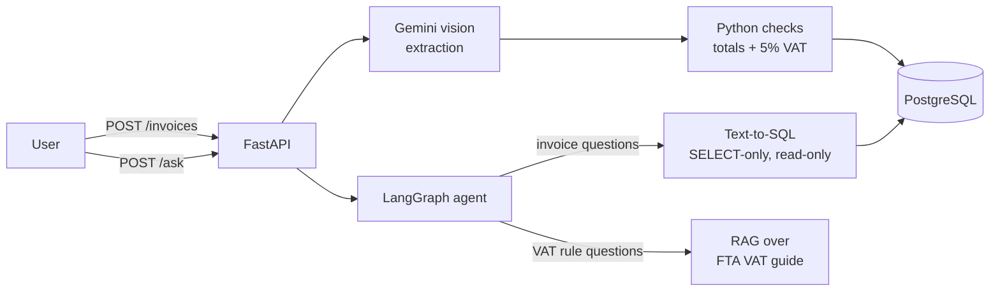

# FinDoc AI: UAE Invoice & VAT Copilot

FinDoc AI reads UAE tax invoices from images, checks their VAT, stores them in PostgreSQL, and answers questions in plain English, both about your own invoices and about UAE VAT rules, with citations from the official FTA guide.

> Built as a learning project to show how an LLM application works end to end: extraction, validation, storage, text-to-SQL, RAG, an agent, an API and containers.

## The problem

Small businesses in the UAE receive many supplier invoices every month. Someone types each one into a spreadsheet, checks the VAT by hand, and searches long FTA guides when a VAT question comes up. Typing mistakes, wrong VAT charged by a supplier, or the same invoice counted twice all end up in the VAT return.

## What it does

1. **Reads an invoice image** with a vision LLM (Gemini) into a fixed Pydantic schema: vendor, invoice number, date, subtotal, VAT and total.
2. **Checks it with plain Python**: subtotal + VAT = total, and VAT = 5% of the subtotal. The model reads; the code checks.
3. **Stores it in PostgreSQL**, with money as `NUMERIC(12,2)` and a unique index that blocks the same invoice being saved twice (vendor name compared case-insensitively).
4. **Answers questions** through a LangGraph agent that chooses a tool:
   - **Invoice questions** ("What was my total VAT in March 2026?") → guarded text-to-SQL: only single `SELECT` statements pass a check, and the query runs on a read-only connection.
   - **VAT rule questions** ("Do I have to register if my sales are AED 400,000?") → RAG over the FTA Taxable Person Guide, answering only from the retrieved passages and citing section and page.
5. **Serves it all through FastAPI** and runs with **Docker Compose** (API + PostgreSQL with pgvector).

## Architecture



## Results

| Test | Result |
|---|---|
| Synthetic test set (8 invoices, 48 fields: banner layout, phone photo, wrong VAT, USD, discounts, DD/MM receipt, total mismatch, very blurry) | **90–96% field accuracy** across runs |
| Real UAE tax invoices (phone photos, Arabic + English, stamps, watermarks) | **12/12 fields correct** |
| Real supplier document with a wrongly printed VAT line | Model copied the printed value exactly; the checks flagged both problems |

**What real documents taught me:** extraction was accurate, but the system logic had gaps. A sales quotation was accepted as an invoice, a sales invoice would be counted as a purchase, and a USD invoice was stored as if it were AED. These are next on the roadmap (document type, review status, currency).

## Tech stack

Python 3.13 · Google Gemini (`google-genai`) · Pydantic · PostgreSQL 18 · psycopg 3 · LangGraph · LangChain · FastAPI · Docker · Docker Compose · pypdf

## Run it with Docker

You need Docker Desktop and a Gemini API key.

```bash
git clone https://github.com/Vyshnav644/findoc-ai.git
cd findoc-ai
cp .env.example .env        # then fill in your own values
```

**One-time: build the VAT guide index.** Download the FTA Taxable Person Guide (link in `knowledge/sources.md`) into `knowledge/`, then create the embeddings with a local Python environment:

```bash
python -m venv .venv
.venv\Scripts\activate        # Windows (macOS/Linux: source .venv/bin/activate)
pip install -r requirements.txt
python embed_guide.py
```

**Start everything:**

```bash
docker compose up -d --build
```

Open http://localhost:8000/docs, upload an invoice from `samples/` with `POST /invoices`, then ask questions with `POST /ask`.

The database table is created automatically on the first start, and the API waits for the database healthcheck before starting.

### Backups

```bash
docker compose exec db pg_dump -U postgres -d findoc -Fc -f /tmp/findoc.dump
docker compose cp db:/tmp/findoc.dump backups/findoc_YYYY-MM-DD.dump
```

Restore was tested by deleting the volume and rebuilding from the backup with `pg_restore`.

## API

| Endpoint | What it does |
|---|---|
| `GET /health` | Check the server is running |
| `GET /info` | App name and model in use |
| `POST /invoices` | Upload a PNG, JPEG or WebP invoice → extracted fields, problems found, saved or duplicate |
| `POST /ask` | Ask a question → answer plus the tools the agent used; `conversation_id` keeps memory per conversation |

## Evaluation

```bash
python evaluate_invoices.py
```

Scores extraction against `samples/test_set/ground_truth.json`. It never saves to the database, counts failures as wrong, and should be run more than once because LLM output varies between runs.

## Data and privacy

- The repository contains **synthetic invoices only**.
- Real invoices are kept in a git-ignored folder and are never committed.
- Secrets live in `.env` (git-ignored and excluded from the Docker image); `.env.example` holds placeholders only.
- The free Gemini tier may use submitted data to improve Google's products. A production version would use a paid tier with data-protection terms, a UAE cloud region, or a self-hosted model.

## Roadmap

- [x] Vision LLM extraction into a Pydantic schema
- [x] Arithmetic and 5% VAT checks
- [x] PostgreSQL storage with duplicate protection
- [x] Guarded text-to-SQL
- [x] RAG over the FTA VAT guide with citations
- [x] LangGraph agent with tools and conversation memory
- [x] FastAPI endpoints
- [x] Evaluation on synthetic and real invoices
- [x] Docker and Docker Compose (healthcheck, automatic schema, tested backups)
- [ ] Document type, review status and currency columns
- [ ] Guide embeddings in pgvector with an HNSW index
- [ ] Streamlit screen: upload, chat and a VAT dashboard
- [ ] Tests and GitHub Actions CI
- [ ] Cloud deployment (AWS or Azure)
- [ ] PDF and Arabic-only invoices
